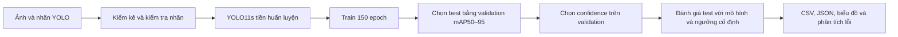
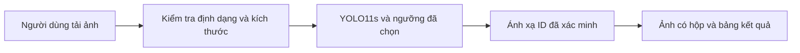

# BÁO CÁO DỰ ÁN

# HUẤN LUYỆN VÀ ĐÁNH GIÁ MÔ HÌNH YOLO11s CHO PHÁT HIỆN THỰC PHẨM VIỆT NAM TRÊN DỮ LIỆU VIETFOOD68

**Lĩnh vực:** Trí tuệ nhân tạo – Thị giác máy tính  
**Sinh viên thực hiện:** Nguyễn Ngọc Kiều Trinh  
**Lớp:** K70A2 – Khoa Toán – Cơ – Tin học  
**Đơn vị:** Trường Đại học Khoa học Tự nhiên, Đại học Quốc gia Hà Nội  
**Giảng viên hướng dẫn:** Chưa được cung cấp  
**Ngày cập nhật thực nghiệm:** 12/10/2026  
**Mã lần huấn luyện:** `vietfood68_5070-2`

Thông tin sinh viên và đơn vị được giữ theo bản báo cáo ban đầu. VietFood68 là tên dùng trong dự án; nguồn được dẫn ban đầu có tên công bố **VietFood67**, với 68 lớp gồm cả lớp người. Báo cáo sử dụng ID lớp của dữ liệu trên máy; chưa xác nhận đầy đủ bảng ánh xạ tên lớp của bản dữ liệu này.

---

## TÓM TẮT

Đề tài xây dựng quy trình huấn luyện, suy luận và đánh giá phát hiện đối tượng bằng **YOLO11s**, sử dụng dữ liệu ảnh và nhãn YOLO tại `D:\archive\dataset`. Bộ dữ liệu thực nghiệm có 161.733 ảnh train, 6.602 ảnh validation và 3.284 ảnh test, với 68 ID lớp. Mô hình được khởi tạo từ trọng số tiền huấn luyện `yolo11s.pt` và hoàn tất 150 epoch trên NVIDIA GeForce RTX 5070 12 GB. Quy trình có điều chỉnh batch và bộ nạp dữ liệu để xử lý tình trạng thiếu RAM trên Windows.

Trọng số tốt nhất theo mAP50–95 trên validation nằm ở epoch 150. Đánh giá riêng toàn bộ test cho **Precision @@TEST_P@@%, Recall @@TEST_R@@%, mAP50 @@TEST_MAP50@@% và mAP50–95 @@TEST_MAP@@%**. Với ngưỡng confidence @@VAL_CONF@@ được chọn trên validation rồi giữ cố định cho test, phép đếm ở IoU 0,50 thu được 5.316 TP, 222 FP và 354 FN, tương ứng precision gộp @@OP_P@@% và recall gộp @@OP_R@@%.

Kiểm tra nhãn không phát hiện dòng sai cấu trúc, nhãn thiếu hoặc ID ngoài phạm vi. Kiểm tra SHA-256 không phát hiện ảnh giống hệt byte giữa các tập. Tuy nhiên, tên file có dấu vết ảnh xuất từ Roboflow và khung hình video; chưa kiểm chứng việc tách theo ảnh nguồn/video. Các kết quả vì vậy phản ánh chất lượng trên bản chia dữ liệu hiện có, chưa chứng minh khả năng tổng quát ngoài môi trường này. Sản phẩm hiện có là mô hình và công cụ dòng lệnh; giao diện Streamlit là thiết kế đề xuất, chưa triển khai.

**Từ khóa:** YOLO11s; phát hiện đối tượng; thực phẩm Việt Nam; VietFood67; RTX 5070; mAP; đánh giá test.

## MỤC LỤC

1. Đặt vấn đề và mục tiêu
2. Nghiên cứu liên quan và cơ sở lý thuyết
3. Dữ liệu và kiểm tra chất lượng
4. Phương pháp và tổ chức hệ thống
5. Môi trường và cấu hình thực nghiệm
6. Quy trình đánh giá
7. Kết quả và thảo luận
8. Phân tích lỗi và kiểm thử
9. Thiết kế ứng dụng và hướng phát triển
10. Hạn chế, khả năng tái lập và kết luận
11. Tài liệu tham khảo
12. Phụ lục: số liệu từng lớp, lệnh chạy và hiện vật thực nghiệm

## DANH MỤC TỪ VIẾT TẮT

| Ký hiệu | Ý nghĩa |
| --- | --- |
| YOLO | You Only Look Once |
| GT | Ground truth: đối tượng đã được gán nhãn |
| TP / FP / FN | Phát hiện đúng / phát hiện sai / đối tượng bị bỏ sót theo quy tắc đánh giá |
| IoU | Intersection over Union: độ giao nhau trên hợp của hai hộp |
| AP / mAP | Average Precision / trung bình AP giữa các lớp |
| NMS | Non-Maximum Suppression: loại bỏ dự đoán chồng lặp |
| AMP | Automatic Mixed Precision: tính toán với nhiều mức chính xác |
| DFL | Distribution Focal Loss |
| VRAM | Bộ nhớ riêng của GPU |

---

## 1. ĐẶT VẤN ĐỀ VÀ MỤC TIÊU

### 1.1. Bài toán

Một ảnh thực phẩm có thể chứa nhiều món, nguyên liệu và đối tượng phụ trợ. Phân loại toàn ảnh chỉ cung cấp nhãn ảnh, trong khi phát hiện đối tượng cần trả về đồng thời **vị trí hộp, ID lớp và độ tin cậy** cho từng đối tượng. Đề tài lựa chọn bài toán thứ hai để hỗ trợ quan sát món ăn và thành phần trong ảnh.

Khó khăn thực tế gồm vật thể nhỏ, che khuất, thành phần nằm sát nhau, khác biệt góc nhìn và quy tắc gán nhãn không đồng nhất. Mô hình còn cần chạy ổn định trên máy cá nhân, nơi tài nguyên GPU, RAM và dung lượng đĩa đều có giới hạn. Vì vậy, chất lượng đánh giá và ổn định vận hành được xem là hai yêu cầu đồng thời.

### 1.2. Mục tiêu và phạm vi

| Mục tiêu | Tiêu chí kiểm chứng | Kết quả thực hiện |
| --- | --- | --- |
| Chuẩn bị dữ liệu YOLO 68 lớp | Kiểm kê ảnh, nhãn, ID và định dạng | Đã kiểm tra toàn bộ nhãn |
| Huấn luyện trên RTX 5070 | Hoàn tất số epoch và lưu checkpoint | Hoàn tất 150 epoch |
| Đánh giá mô hình | Tách số liệu validation và test | Đã đánh giá riêng cả hai tập |
| Phân tích chất lượng | Kết quả từng lớp, FP/FN, hình minh họa | Có CSV, JSON và biểu đồ kèm báo cáo |
| Suy luận trên ảnh | Chạy được mô hình đã huấn luyện | Đã chạy benchmark trên 100 ảnh test |
| Giao diện người dùng | Tải ảnh và hiển thị tên món đúng | Đã thiết kế; chưa có ứng dụng trong repo |

Đóng góp thực tế của dự án là quy trình huấn luyện và đánh giá có thể kiểm tra lại, cùng cách giới hạn bộ nhớ bộ nạp dữ liệu trên Windows. Đề tài sử dụng kiến trúc có sẵn, không đề xuất kiến trúc YOLO mới. Nhận diện khẩu phần, tính calo, khảo sát người dùng và triển khai web chưa thuộc kết quả đã hoàn thành.

## 2. NGHIÊN CỨU LIÊN QUAN VÀ CƠ SỞ LÝ THUYẾT

### 2.1. Các công trình tham khảo

YOLO gốc của Redmon và cộng sự biểu diễn phát hiện đối tượng bằng dự đoán hộp và xác suất lớp trong một mạng, tạo nền tảng cho họ mô hình phát hiện một giai đoạn. Kiến trúc YOLO11 trong đề tài là thế hệ triển khai của Ultralytics, không đồng nhất với kiến trúc YOLO gốc. [1](https://arxiv.org/abs/1506.02640)

| Công trình | Bài toán và dữ liệu | Giá trị tham khảo cho đề tài |
| --- | --- | --- |
| Redmon và cộng sự, YOLO (2016) | Phát hiện đối tượng | Cách tiếp cận dự đoán hộp và lớp trong một mạng [1] |
| Nguyen và cộng sự, VinaFood21 (2021) | Nhận dạng thực phẩm; 13.950 ảnh, 21 loại món | Bối cảnh nghiên cứu ảnh thực phẩm Việt Nam; khác bộ dữ liệu và bài toán [2] |
| Nguyen và cộng sự, VietFood67 / FoodDetector (2025) | 33.003 ảnh, 68 lớp có cả khuôn mặt người; YOLOv10 | Nguồn liên quan trực tiếp đến tên bộ dữ liệu; mô hình tham khảo công bố mAP50 0,92 [3] |
| Ultralytics YOLO11 (2024) | Họ mô hình phát hiện và các tác vụ thị giác khác | Kiến trúc và thư viện thực nghiệm được sử dụng [4] |

VinaFood21 nghiên cứu nhận dạng món ăn với CNN. Kết quả accuracy của phân loại không so sánh trực tiếp với mAP của phát hiện đối tượng. [2](https://arxiv.org/abs/2108.02929)

Bài báo VietFood67 cung cấp bối cảnh phù hợp hơn vì có nhãn hộp và lớp người. Tuy nhiên, báo cáo này đo trên 171.619 file ảnh đã có trên máy, lớn hơn số ảnh gốc công bố. Chưa có quy trình tạo bản dữ liệu này hoặc cùng giao thức chia tập để đối chiếu. Vì vậy, mAP50 test @@TEST_MAP50@@% của dự án **không đủ cơ sở kết luận vượt YOLOv10 92% trong công trình tham khảo**. [3](https://link.springer.com/chapter/10.1007/978-981-96-4288-5_35)

### 2.2. Kiến trúc sử dụng: YOLO11s

YOLO11 có các biến thể n, s, m, l và x; đề tài dùng biến thể **s**. Trọng số khởi tạo `yolo11s.pt` hỗ trợ chuyển giao từ dữ liệu tiền huấn luyện sang bộ lớp mới. [4](https://docs.ultralytics.com/models/yolo11/)

Kiểm tra trực tiếp cấu hình trong checkpoint xác nhận `yaml_file=yolo11s.yaml`, `scale=s`, `nc=68`, ảnh RGB 3 kênh. Backbone chứa các khối Conv, C3k2, SPPF và C2PSA; phần head kết hợp đặc trưng qua upsample/concat và đưa ba mức đặc trưng vào Detect. Cách tổ chức backbone–neck–head và các khối này phù hợp mô tả kiến trúc chính thức. [5](https://docs.ultralytics.com/guides/yolo-architecture/)

Mô hình trong checkpoint có **9.454.108 tham số**; sau hợp nhất Conv/BatchNorm khi đánh giá còn **9.439.116 tham số**, được log là 21,6 GFLOPs. Trọng số `best.pt` có kích thước **19.226.330 byte**. Đây là số đo của mô hình 68 lớp đang sử dụng, không lấy kích thước mô hình 80 lớp trên COCO thay cho thực nghiệm.

### 2.3. Chỉ số đánh giá

Với một ngưỡng IoU cố định, dự đoán đúng cần trùng lớp với GT và đủ mức chồng lấp, theo quy tắc ghép cặp một–một. Dự đoán không ghép được tính FP; GT không ghép được tính FN. Các công thức đếm:

```text
IoU       = diện tích giao / diện tích hợp
Precision = TP / (TP + FP)
Recall    = TP / (TP + FN)
F1        = 2 × Precision × Recall / (Precision + Recall)
```

Precision cao cho biết phần lớn dự đoán được giữ là đúng; recall cao cho biết ít GT bị bỏ sót. Confidence là điểm mô hình xuất ra và ngưỡng lọc, không phải accuracy của toàn hệ thống. [6](https://docs.ultralytics.com/guides/yolo-performance-metrics/)

AP tổng hợp đường precision–recall theo confidence cho từng lớp. **mAP50** lấy trung bình AP của các lớp ở IoU 0,50. **mAP50–95** tiếp tục lấy trung bình trên 10 mức IoU từ 0,50 đến 0,95, bước 0,05, nên nhạy hơn với độ chính xác vị trí hộp. Quy ước nhiều mức IoU được sử dụng trong đánh giá COCO; báo cáo này dùng cách tính AP của Ultralytics trên nhãn YOLO, không coi đó là kết quả trên tập COCO. [7](https://cocodataset.org/#detection-eval)

**Macro** là trung bình đều giữa các lớp có GT; **micro** cộng TP/FP/FN trên tất cả lớp rồi tính tỷ lệ. Các lớp nhiều mẫu chi phối micro mạnh hơn. Báo cáo ghi rõ cách tổng hợp và ngưỡng confidence khi so sánh kết quả.

### 2.4. Hàm mất mát

Theo log thực nghiệm, mô hình tối ưu ba thành phần: `box_loss` cho định vị hộp, `cls_loss` cho dự đoán lớp và `dfl_loss` cho biểu diễn phân phối tọa độ hộp. Cấu hình hệ số tương ứng là 7,5; 0,5 và 1,5. Các giá trị loss không phải phần trăm lỗi; không so trực tiếp trị số box loss với cls loss để kết luận thành phần nào tốt hơn. Xu hướng giảm qua epoch có ý nghĩa hơn giá trị đơn lẻ.

Loss train và validation được tính trong điều kiện khác nhau, đặc biệt train có augmentation. Khoảng cách giữa hai đường vì vậy cần đọc cùng mAP và quy trình dữ liệu, không tự động đồng nghĩa với overfitting.

## 3. DỮ LIỆU VÀ KIỂM TRA CHẤT LƯỢNG

### 3.1. Nguồn và phạm vi xác minh

Bản báo cáo ban đầu dẫn trang Kaggle `thomasnguyen6868/vietfood68`, hiện được công bố dưới tên **VietFood67**. Repo FoodDetector của tác giả mô tả 68 lớp, trong đó có lớp người, và cung cấp danh sách tên tham chiếu. [8](https://www.kaggle.com/datasets/thomasnguyen6868/vietfood68), [9](https://github.com/nvhnam/FoodDetector)

Trong bản dữ liệu trên máy chỉ tìm thấy thư mục ảnh và nhãn; `data.yaml` của dự án hiện đặt tên `class_0` đến `class_67`. Chưa có manifest phiên bản tải xuống, cấu hình xuất Roboflow hay bảng tên lớp gốc kèm theo. Do đó cần phân biệt **nguồn được dẫn** với **nguồn gốc đã kiểm chứng của từng file hiện có**.

Đối chiếu danh sách `class_names.py` từ repo tác giả cho thấy các ID tham chiếu 8, 27, 47, 50, 52 lần lượt là bò kho, người, phô mai, thịt bò, thịt heo. Những ID này phù hợp với các mẫu minh họa đã quan sát. Đây là bằng chứng hỗ trợ thứ tự lớp, chưa thay thế xác minh toàn bộ 68 ID của bản dữ liệu cục bộ. Không gán lại tên trong checkpoint chỉ dựa vào tên bộ dữ liệu. [10](https://raw.githubusercontent.com/nvhnam/FoodDetector/v2/class_names.py)

### 3.2. Tổ chức dữ liệu

```text
D:\archive\dataset\
├── images\
│   ├── train\
│   ├── valid\
│   └── test\
└── labels\
    ├── train\
    ├── valid\
    └── test\
```

Mỗi ảnh có một file `.txt` cùng stem. Một dòng nhãn có dạng:

```text
class_id x_center y_center width height
```

Các tọa độ được chuẩn hóa theo chiều rộng và chiều cao ảnh. File nhãn rỗng biểu diễn ảnh không có đối tượng được gán nhãn, không mặc định là file hỏng. Nhãn hợp lệ về số học chưa chứng minh đối tượng đã được gán đầy đủ hoặc chính xác về ngữ nghĩa.

### 3.3. Thống kê kiểm kê

**Bảng 1. Số lượng ảnh, nhãn và đối tượng trong bản dữ liệu thực nghiệm.**

@@DATASET_TABLE@@

Tổng số file ảnh là **171.619**, tổng số hộp gán nhãn là **888.195**. Số ảnh train chiếm @@TRAIN_SHARE@@%; validation @@VAL_SHARE@@%; test @@TEST_SHARE@@%. Đây là tỷ lệ file hiện có, không phải tỷ lệ ảnh nguồn độc lập. Kích thước tổng file ảnh khoảng **@@DATA_GIB@@ GiB**; kích thước sau giải mã trong RAM có thể lớn hơn nhiều.

Train trung bình @@TRAIN_INST_PER_IMG@@ hộp/ảnh, trong khi validation @@VAL_INST_PER_IMG@@ và test @@TEST_INST_PER_IMG@@ hộp/ảnh. Khác biệt này cần được đối chiếu với quy trình augmentation/xuất dữ liệu trước khi xem ba tập có cùng phân phối. Báo cáo không suy ra số ảnh gốc từ số file train.

### 3.4. Kiểm tra chất lượng và trùng lặp

Script `audit_dataset.py` kiểm tra toàn bộ file nhãn: mỗi dòng phải có 5 giá trị hữu hạn; ID nguyên từ 0 đến 67; tọa độ nằm trong [0,1]; chiều rộng và cao dương. Kết quả: **0 dòng sai, 0 nhãn thiếu, 0 nhãn không có ảnh tương ứng**; cả ba tập đều có đủ 68 ID. Phép kiểm tra này chưa kiểm chứng tính nhất quán ngữ nghĩa, các hộp nằm hoàn toàn trong ảnh hay mọi trường hợp hộp lặp. Evaluator đã đọc đủ 6.602 ảnh validation và 3.284 ảnh test, không báo ảnh lỗi trong hai tập này.

Kiểm tra trùng byte dùng SHA-256 cho tất cả ảnh validation/test và các ảnh train có kích thước file trùng ứng viên. Tổng cộng **17.990 file** được băm. Những file khác kích thước không thể giống hệt byte nên được loại an toàn trước khi băm. Kết quả có **0 nhóm ảnh giống hệt byte giữa các tập**.

Sau khi bỏ hậu tố `.rf.`, có 336 tên gốc trùng giữa train–validation và 298 giữa train–test; tương ứng 4.747 file validation và 2.330 file test mang tên gốc có xuất hiện ở train. Nhiều tên chỉ là `100_jpg`, `101_jpg` nên trùng tên **không chứng minh trùng ảnh nguồn**. Ngược lại, SHA-256 khác nhau cũng không loại được ảnh gần trùng, ảnh biến đổi hoặc khung hình cùng video. Cần manifest nguồn và kiểm tra tương đồng ảnh trước khi xác nhận việc chia tập độc lập.

### 3.5. Phân bố lớp


**Hình 1.** Mỗi cột biểu diễn số hộp, không phải số ảnh; một ảnh có thể đóng góp cho nhiều lớp.

Số hộp train theo lớp nằm trong khoảng 5.193–48.477, chênh lệch khoảng @@IMBALANCE@@ lần. Test chỉ có 29–323 hộp mỗi lớp. Bên cạnh mAP trung bình, cần theo dõi lớp ít mẫu và lớp có AP thấp; biến động một vài dự đoán có thể ảnh hưởng lớn đến tỷ lệ của lớp ít mẫu. Số liệu từng lớp được lưu tại [dataset_class_counts.csv](reports/evaluation/dataset_class_counts.csv).

## 4. PHƯƠNG PHÁP VÀ TỔ CHỨC HỆ THỐNG

### 4.1. Luồng thực nghiệm



Test chỉ được dùng đánh giá sau khi training hoàn tất. Trong lượt đánh giá báo cáo, không dùng test để chọn epoch hoặc điều chỉnh trọng số. Ngưỡng vận hành được chọn từ đường F1 của validation; mAP vẫn được tính từ dự đoán ở confidence sàn thấp để bảo toàn đường precision–recall.

### 4.2. Tiền xử lý và augmentation

Train dùng ảnh RGB, `imgsz=640` và `rect=False`. Thư viện xử lý resize/letterbox và hộp tương ứng. Cấu hình augmentation thực tế gồm HSV (`h=0,015`, `s=0,7`, `v=0,4`), dịch chuyển `translate=0,1`, thay đổi tỷ lệ `scale=0,5`, lật ngang `fliplr=0,5` và mosaic với xác suất 1,0 trước giai đoạn đóng mosaic. Xoay, shear, perspective, lật dọc, mixup, cutmix và copy-paste đặt bằng 0.

`close_mosaic=10` đóng mosaic trong 10 epoch cuối, từ epoch 141. Hình train tại giai đoạn này được lưu trong thư mục run. Những trường như `auto_augment` và `erasing` có thể xuất hiện trong cấu hình chung của thư viện; báo cáo không coi chúng là augmentation detection đã áp dụng chỉ vì có trong YAML.

Validation/test không dùng tăng cường dữ liệu lúc đánh giá (`augment=False`). Lượt đánh giá dùng `rect=True` để ghép theo tỷ lệ ảnh và căn theo stride. Vì vậy `imgsz=640` là kích thước cấu hình, không bảo đảm mọi tensor đều đúng 640×640; hình vuông có thể được padding lên 672×672 trong evaluator phiên bản đang dùng. Suy luận benchmark sử dụng `rect=False`, tensor cố định 640×640. [11](https://docs.ultralytics.com/modes/val/)

### 4.3. Các thành phần mã nguồn

| File | Vai trò |
| --- | --- |
| [data.yaml](data.yaml) | Đường dẫn ba tập và danh sách ID lớp |
| [check_gpu.py](check_gpu.py) | Kiểm tra CUDA và phép toán có backward |
| [train.py](train.py) | Tham số train, AMP, AutoBatch, resume và đường dẫn output |
| [memory_trainer.py](memory_trainer.py) | Giới hạn worker/prefetch; validation dùng 0 worker |
| [evaluate.py](evaluate.py) | Đánh giá validation/test, chọn ngưỡng và lưu số liệu |
| [audit_dataset.py](audit_dataset.py) | Kiểm kê nhãn và trùng ảnh byte |
| [analyze_results.py](analyze_results.py) | Biểu đồ và phân tích lỗi từng ảnh |
| [benchmark_inference.py](benchmark_inference.py) | Đo suy luận từng ảnh trên mẫu test cố định |
| [render_report.py](render_report.py) | Điền số đo và bảng vào mẫu báo cáo |

## 5. MÔI TRƯỜNG VÀ CẤU HÌNH THỰC NGHIỆM

### 5.1. Phần cứng và phần mềm

**Bảng 2. Môi trường đo trực tiếp trên máy chạy.**

| Thành phần | Giá trị |
| --- | --- |
| Hệ điều hành | Windows 11 Pro, build 26200; chạy Windows native |
| GPU | NVIDIA GeForce RTX 5070 desktop, 12 GB |
| CPU | AMD Ryzen 5 7600X3D; 6 lõi vật lý, 12 luồng logic |
| RAM | 32 GB lắp đặt; hệ điều hành báo khoảng 31,11 GiB khả dụng tổng |
| Python | 3.12.13 |
| Ultralytics | 8.4.175 |
| PyTorch / torchvision | 2.8.0+cu128 / 0.23.0+cu128 |
| CUDA runtime của PyTorch | 12.8 |
| Driver NVIDIA | 617.14 |
| OpenCV | 5.0.0.93 |
| Nơi lưu dataset / run | Ổ D; môi trường `.venv` trong repo là junction sang D |

CUDA runtime của PyTorch khác phiên bản CUDA tối đa driver hỗ trợ. Không cần diễn giải số CUDA do `nvidia-smi` hiển thị là phiên bản runtime của training. Phiên bản thư viện trước và sau đánh giá được chụp tại [environment-freeze.txt](reports/evaluation/environment-freeze.txt) và [environment-freeze-final.txt](reports/evaluation/environment-freeze-final.txt). Lượt `save_json=True` tự bổ sung `faster-coco-eval==1.8.0`; không thay đổi phiên bản PyTorch, Ultralytics hoặc các thư viện training đang có. Các bảng mAP chính vẫn lấy từ evaluator native, không trộn thêm chỉ số COCO theo kích thước vật thể.

### 5.2. Cấu hình huấn luyện

**Bảng 3. Cấu hình cuối được đối chiếu với `args.yaml` và mã nguồn.**

| Tham số | Cấu hình thực nghiệm |
| --- | --- |
| Model / khởi tạo | YOLO11s / `yolo11s.pt` tiền huấn luyện |
| Số lớp | 68 |
| Epoch | 150; hoàn tất đủ 150 |
| Kích thước train | 640×640, `rect=False` |
| Batch | 28 ở giai đoạn đầu; 36 từ epoch 73 |
| Train workers / prefetch cuối | 4 worker / 2 batch mỗi worker |
| Validation workers trong train | 0, do trainer tùy chỉnh |
| Image cache | Tắt (`cache=False`) |
| Device / AMP | CUDA:0 / bật |
| Optimizer thực tế | MuSGD, được chọn từ chế độ `auto` |
| `lr0`, `lrf`, momentum | 0,01; 0,01; 0,937 trong cấu hình lưu |
| Weight decay / warmup | 0,0005 / 3 epoch |
| Lịch learning rate | Cosine (`cos_lr=True`) |
| `nbs` | 64; batch thực có thể kết hợp gradient accumulation |
| Seed / deterministic | 42 / False |
| Early stopping | `patience=30` |
| Đóng mosaic | 10 epoch cuối |
| Lưu định kỳ | `save_period=10`; ngoài `best.pt` và `last.pt` |

MuSGD được ghi trong cấu hình cuối, không thay bằng AdamW khi mô tả. Chế độ `auto` của thư viện có thể tự chọn optimizer và learning rate; các giá trị cấu hình không thay thế việc kiểm tra log learning rate thực tế. Cột `lr/pg*` đã được lưu trong `results.csv`. [12](https://docs.ultralytics.com/modes/train/)

`nbs=64` không có nghĩa batch vật lý luôn 64. Với quy tắc tích lũy của phiên bản đang dùng, batch 28 cho khoảng 56 ảnh mỗi bước cập nhật sau warmup, batch 36 cho khoảng 72. Thay batch có thể thay đổi đường tối ưu. Vì các thay đổi xảy ra trong cùng run, không thể quy toàn bộ mức tăng precision cho batch lớn hơn.

### 5.3. Tối ưu bộ nhớ và lưu trữ

Trong quá trình chạy, máy từng có RAM dùng khoảng 30,4 GB và committed memory 61,5/62,5 GB. Lỗi OpenCV báo không cấp phát được khoảng 6,2 MB xảy ra ở DataLoader worker; đây là tình trạng bộ nhớ hệ thống, không phải chỉ nhìn VRAM để chẩn đoán.

DataLoader worker chuẩn bị ảnh ở phía CPU; nhiều worker và hàng đợi prefetch làm nhiều batch tồn tại đồng thời. Trên Windows, các tiến trình có thể giữ bản sao cấu trúc dataset; train và validation có thể cùng giữ pool. Tài liệu PyTorch mô tả rõ mối liên hệ worker, prefetch và bộ nhớ tiến trình. [13](https://docs.pytorch.org/docs/2.8/data.html)

Giải pháp áp dụng trong repo: tắt cache ảnh RAM, giảm/kiểm soát prefetch, giữ validation 0 worker và tăng train worker từng bước. Hồ sơ cuối có 4×2=8 batch prefetch danh nghĩa, ngoài batch đang xử lý và các buffer khác. AMP được bật để giảm một phần chi phí tính toán/bộ nhớ GPU; AMP không giới hạn tổng RAM của worker. [14](https://docs.pytorch.org/docs/2.8/amp.html)

Dataset, run và môi trường Python được chuyển sang D. Tuy nhiên, chuyển output không đồng nghĩa mọi file hệ thống chuyển theo: pagefile và một số thư mục tạm vẫn có thể dùng C. Báo cáo không xác nhận đã di chuyển pagefile. Cần theo dõi RAM committed và dung lượng C cùng GPU memory.

### 5.4. Thời gian và các lần tiếp tục train

CSV có đủ 150 epoch nhưng cột `time` bị đặt lại ở các lần resume. Không dùng giá trị `time` cuối như tổng thời gian chạy từ đầu và không cộng mù mọi chênh lệch âm/dương. Trong đoạn ổn định **epoch 74–150**, chênh lệch thời gian giữa hai dòng liên tiếp có trung vị **@@EPOCH_MIN@@ phút/epoch**, khoảng **@@EPOCH_MIN_RANGE@@–@@EPOCH_MAX_RANGE@@ phút**. Đây là thời gian vòng epoch ghi trong CSV, có phần validation và thao tác cuối epoch.

Nếu giữ tốc độ trung vị này từ đầu, 150 epoch tương đương khoảng **@@EST_HOURS@@ giờ**. Con số này là ước lượng theo tốc độ của đoạn ổn định, không phải tổng thời gian thực tế đã đo cho run có gián đoạn. Chưa có nhật ký đầy đủ để tổng hợp thời gian nghỉ, lần chạy dở và mọi lần restart.

Early stopping theo `patience=30` sẽ dừng khi tiêu chí theo dõi không cải thiện đủ lâu. Run này kết thúc do đạt 150 epoch, không dừng sớm. Sau kết thúc bình thường, checkpoint đã được strip optimizer; không dùng `resume=True` để tiếp tục trạng thái tối ưu đã bị loại khỏi `best.pt`/`last.pt` hiện tại.

## 6. QUY TRÌNH ĐÁNH GIÁ

### 6.1. Chọn mô hình và ngưỡng

1. Chọn `best.pt` theo fitness validation của phiên bản đang dùng. Kiểm tra mã `Metric.fitness` cho trọng số `[0,0,0,1]` với thứ tự P, R, mAP50, mAP50–95, nên tiêu chí chọn là mAP50–95.
2. Đọc toàn bộ CSV: epoch 150 có mAP50–95 cao nhất. Không chọn checkpoint bằng kết quả test.
3. Đánh giá lại best trên toàn bộ validation; chọn confidence **@@VAL_CONF@@** tại cực đại của đường F1 trung bình đã làm trơn theo evaluator.
4. Đánh giá test với cùng trọng số và cấu hình. Giữ confidence đã chọn trên validation khi báo cáo điểm vận hành.

Evaluator native vẫn xuất P/R ở confidence tối ưu F1 riêng của mỗi tập. Ngưỡng native của test là **@@TEST_CONF@@**, chỉ dùng diễn giải bảng mặc định. Báo cáo đồng thời cung cấp điểm vận hành đã khóa theo validation để tránh trình bày việc tối ưu ngưỡng trên test như kết quả triển khai.

### 6.2. Cấu hình evaluator

| Tham số | Giá trị |
| --- | --- |
| Dữ liệu | Toàn bộ validation 6.602 ảnh; toàn bộ test 3.284 ảnh |
| `imgsz`, `rect` | 640, True |
| Batch / workers | 16 / 0 |
| Kiểu tính toán | FP16 trên CUDA:0 |
| Confidence sàn khi tính AP | 0,001 |
| NMS IoU | 0,70 |
| IoU ghép cặp cho AP | 0,50:0,05:0,95 |
| `max_det` | 300 |
| Test-time augmentation | Tắt |
| Output | Đường P/R/F1, confusion matrix, predictions JSON, CSV từng lớp |

NMS IoU 0,70 và IoU ghép cặp 0,50 có hai vai trò khác nhau. Không dùng 0,70 để diễn giải điều kiện TP trong bảng TP/FP/FN. Tham số `half=True` được thư viện chuyển sang FP16; phiên bản hiện tại cảnh báo tên tham số này sắp thay bằng `quantize=16`, nhưng lượt đánh giá đã hoàn thành bình thường.

Script giữ lại thống kê ghép cặp trước khi Ultralytics xóa chúng. Một lượt phân tích độc lập sau đó đọc predictions JSON, lọc theo confidence validation rồi ghép lại với nhãn gốc trên tọa độ ảnh. Các số TP/FP/FN trùng với phép đếm từ evaluator, giúp kiểm tra điểm vận hành. JSON làm tròn bbox đến 3 chữ số thập phân và score đến 5 chữ số; các trường hợp sát ngưỡng cần lưu ý sai số làm tròn.

### 6.3. Quy tắc đọc confusion matrix

Ma trận mặc định của lượt val/test dùng confidence sàn **0,001** và IoU hình học **0,45**, nên không đại diện trực tiếp cho ngưỡng triển khai. Báo cáo tạo thêm ma trận tại **confidence @@VAL_CONF@@, IoU 0,50**. Hàng là lớp dự đoán, cột là GT; hàng/cột cuối biểu diễn background/bỏ sót.

Ghép cặp hình học của confusion matrix không bắt buộc cùng lớp trước khi ghép; cách ghép của AP có điều kiện cùng lớp. Do đó không bắt buộc tổng đường chéo của matrix bằng TP từ AP trong mọi trường hợp có hộp chồng nhau. Không lấy matrix mặc định để suy lại P/R ở confidence khác.

## 7. KẾT QUẢ VÀ THẢO LUẬN

### 7.1. Diễn biến huấn luyện


**Hình 2.** Vạch chấm tại epoch 73 đánh dấu batch 36; vạch đứt tại epoch 141 đánh dấu đóng mosaic. Các mốc biểu diễn thay đổi cấu hình, không chứng minh tác động nhân quả của chúng.

**Bảng 4. Một số mốc từ log huấn luyện; chỉ số đều tính trên validation.**

@@EPOCH_TABLE@@

Từ epoch 1 đến 150, precision tăng **36,53 điểm phần trăm**, recall tăng **43,47 điểm** và mAP50–95 tăng **43,80 điểm**. Precision có dao động cục bộ; giảm ở một epoch không đủ kết luận mô hình suy giảm dài hạn. Ở giai đoạn cuối, chỉ số vẫn cải thiện nhưng mức tăng nhỏ dần.

Epoch 150 có train box/cls/DFL loss lần lượt **0,35527 / 0,23118 / 0,86684**; validation tương ứng **0,55206 / 0,33274 / 0,96275**. Val box loss và cls loss tiếp tục giảm cùng mAP tăng, nên chưa thấy dấu hiệu suy giảm validation kéo dài trong run này. Tuy nhiên, chưa kiểm chứng nguồn chia tập, chưa có nhiều seed hoặc tập ngoài miền để loại trừ overfitting hay ước lượng bất định.

### 7.2. Kết quả tổng thể

**Bảng 5. So sánh log cuối, đánh giá lại validation và test. Đơn vị chỉ số: %.**

@@METRICS_TABLE@@

Số validation đánh giá lại có chênh lệch nhỏ với log cuối do điều kiện evaluator như batch và tính toán FP16; mức chênh lệch không làm thay đổi kết luận về run. Test có mAP50–95 cao hơn validation khoảng **@@TEST_VAL_MAP_DIFF@@ điểm phần trăm**. Không diễn giải điều đó là test tốt hơn mọi tình huống thực tế; độ khó, phân bố đối tượng và mẫu của từng tập có thể khác nhau.

Kết quả test @@TEST_P@@% precision cho thấy mục tiêu trên 95% đã đạt theo **cách tổng hợp native của evaluator**. Đây không phải tỷ lệ ảnh nhận diện đúng hoàn toàn, không phải precision của mọi lớp, và không phải bảo đảm cho ảnh mới ngoài bộ dữ liệu.

### 7.3. Ảnh hưởng ngưỡng confidence

**Bảng 6. TP/FP/FN test ở IoU 0,50; P/R là micro.**

@@THRESHOLD_TABLE@@

Ngưỡng khóa theo validation giảm FP từ 508 xuống 222 so với 0,25, đồng thời tăng FN từ 215 lên 354. Mức đánh đổi này phù hợp khi ưu tiên ít phát hiện sai; hệ thống cần quan sát đầy đủ thành phần có thể chọn ngưỡng thấp hơn và chấp nhận thêm FP. Việc lựa chọn phải xuất phát từ mục tiêu ứng dụng và validation.

Ở confidence @@VAL_CONF@@, **macro precision @@OP_MACRO_P@@% và macro recall @@OP_MACRO_R@@%** từ số đếm theo lớp; micro tương ứng @@OP_P@@% và @@OP_R@@%. Native P/R có nội suy trên đường confidence nên có thể khác một chút số đếm trực tiếp tại một ngưỡng. Không trộn hai cách tính để kết luận tăng/giảm chất lượng.


**Hình 3.** Đường từng lớp và đường trung bình từ evaluator, sử dụng confidence sàn 0,001. Hình hỗ trợ quan sát đánh đổi precision–recall; không dùng đường test để lựa chọn ngưỡng triển khai.

### 7.4. Kết quả từng lớp


**Bảng 7. Năm lớp có AP50–95 test thấp nhất; tên vẫn dùng ID cục bộ.**

@@WEAK_CLASSES@@

Lớp `class_20` có AP50 cao hơn AP50–95 rõ rệt, cho thấy khi tăng yêu cầu chồng lấp hộp, kết quả giảm. Điều này gợi ý cần xem chất lượng định vị và quy tắc gán nhãn, không chỉ phân loại. `class_47` có cả P/R và AP50 tương đối thấp, cần rà soát nhận diện lẫn độ hạt của annotation. Mẫu lỗi lớn nhất của lớp này là một hộp GT bao cả khối trong khi dự đoán tách thành nhiều hộp nhỏ.

**Bảng 8. Năm lớp có AP50–95 test cao nhất.**

@@BEST_CLASSES@@

Số mẫu GT đi cùng AP giúp tránh kết luận từ một tỷ lệ không có hỗ trợ dữ liệu. Không xếp hạng tên món khi chưa xác nhận mapping. Bảng đủ 68 lớp nằm ở Phụ lục A; CSV gốc chứa P/R, AP và TP/FP/FN.

### 7.5. Tốc độ suy luận

Lượt evaluator test batch 16 báo trung bình **@@EVAL_PRE@@ ms tiền xử lý, @@EVAL_INFER@@ ms forward và @@EVAL_POST@@ ms hậu xử lý mỗi ảnh**. Đây là thời gian nội bộ được chia theo batch; không bao gồm toàn bộ đọc file, tạo báo cáo và giao diện, nên không lấy nghịch đảo forward để quảng bá FPS ứng dụng.

Benchmark riêng dùng 100 ảnh test chọn đều theo danh sách file đã sắp xếp, chạy từng ảnh bằng 100 lời gọi predict riêng, FP16, `rect=False`, tensor 640×640. Warmup 3 ảnh cùng cấu hình không tính vào số đo.

@@BENCHMARK_TABLE@@

Đây là một lượt đo local trên máy hiện có. Wall time có đọc ảnh và overhead Python/API, loại trừ tải model, warmup, vẽ kết quả, mạng và UI. Độ trễ có thể khác khi webcam, export TensorRT, chạy CPU hoặc xử lý đồng thời. Một lượt thử `rect=True` đổi shape đã cho độ trễ dao động lớn; số đo đó được giữ trong `benchmark_dynamic_shapes.json`, không thay cho cấu hình tensor cố định ở bảng trên.

## 8. PHÂN TÍCH LỖI VÀ KIỂM THỬ

### 8.1. Lỗi ở điểm vận hành đã khóa

Phân tích toàn bộ 3.284 ảnh test với confidence @@VAL_CONF@@ và IoU 0,50 cho thấy:

| Quan sát | Số lượng |
| --- | ---: |
| Ảnh có ít nhất một FP hoặc FN | 382 |
| Ảnh có GT và tất cả hộp ghép đúng, không FP/FN | 2.829 |
| Ảnh không có nhãn và không có dự đoán giữ lại | 73 |
| Tổng TP / FP / FN | 5.316 / 222 / 354 |

Theo annotation, có 75 ảnh nền test; 73 không có dự đoán giữ lại. Điều đó không chứng minh mô hình không phát hiện nhầm ở mọi ảnh ngoài 68 lớp. Nhãn rỗng hoặc thiếu annotation cũng có thể làm thay đổi cách ghi nhận lỗi.

**Bảng 9. Phân nhóm hình học của 222 FP, không khẳng định nguyên nhân ngữ nghĩa.**

| Điều kiện quan sát | FP |
| --- | ---: |
| Không có GT nào đạt IoU ≥ 0,50 | 195 |
| Có GT chồng lấp cùng lớp nhưng dự đoán không ghép được | 16 |
| GT có IoU cao nhất đạt 0,50 nhưng khác lớp | 11 |

Nhóm 195 có thể gồm hộp lệch, khác độ hạt gán nhãn hoặc đối tượng chưa có annotation; không gọi tất cả là “nhận diện nhầm món”. Nhóm 16 liên quan đến nhiều dự đoán chồng nhau hoặc xung đột ghép cặp. Cần kiểm tra trực quan trước khi sửa nhãn hoặc thay mô hình.

### 8.2. Minh họa và nhận xét cụ thể


**Hình 5.** Mẫu 1–3 được chọn tự động theo số FP+FN cao nhất. Mẫu 4 là một ảnh nhiều GT được ghép đúng toàn bộ; mẫu 5 là một ảnh đúng khác trong danh sách; mẫu 6 là ảnh nhãn rỗng không có dự đoán. Đây là ví dụ phân tích có chủ đích, không phải mẫu ngẫu nhiên đại diện toàn test.

@@EXAMPLES_TABLE@@

Mẫu 1 có GT `class_47` bao cả khối, còn dự đoán tách thành tám phần; cả tám không đạt điều kiện IoU với hộp lớn. Cần thống nhất “một đối tượng” là cả khối hay từng miếng. Mẫu 2 giữ được hộp món lớn `class_8` nhưng bỏ các hộp thành phần `class_50`. Mẫu 3 cho thấy các hộp thành phần chồng lấp và một số hộp nhỏ bị bỏ sót.

Mẫu 4 đặc biệt đáng chú ý: GT `class_27` bao quanh khuôn mặt/người, cùng nhiều GT `class_33`. Quan sát này phù hợp với lớp người trong nguồn tham chiếu, nên **68 ID không được mô tả là 68 món ăn**. Việc nhiều hộp cùng một ảnh được ghép đúng cũng không thay thế đánh giá theo lớp hoặc tập ngoài miền.

### 8.3. Ma trận nhầm lẫn tại ngưỡng vận hành


**Hình 6.** Hàng dự đoán, cột GT. Ô nền bao gồm FP/FN theo quy tắc matrix. Bản đủ số đếm tại [test_operating_confusion_matrix.csv](reports/evaluation/test_operating_confusion_matrix.csv).

Các cặp nhầm lớp hình học đứng đầu chỉ xuất hiện một lần mỗi cặp, ví dụ GT 36 → dự đoán 8, GT 20 → dự đoán 30, GT 32 → dự đoán 49. Vì hỗ trợ ít, chưa có cơ sở kết luận một cặp món cụ thể bị nhầm thường xuyên. Rà soát định vị, bỏ sót và annotation có ưu tiên cao hơn việc suy diễn tên món từ ID.

### 8.4. Kiểm thử và bằng chứng

| Mã | Nội dung | Kết quả và bằng chứng |
| --- | --- | --- |
| T01 | Ghép ảnh–nhãn và kiểm tra định dạng | Đạt về cấu trúc; audit toàn bộ nhãn, 0 lỗi |
| T02 | Đủ các ID được cấu hình | Đạt; 68/68 ID ở cả ba tập |
| T03 | Trùng file byte giữa các tập | Không phát hiện; SHA-256 và lọc kích thước |
| T04 | Đọc và đánh giá toàn validation/test | Đạt; 6.602 và 3.284 ảnh đã xử lý |
| T05 | Checkpoint đúng kiến trúc và có thể suy luận | Đạt; cấu hình YOLO11s, 68 lớp và benchmark |
| T06 | TP/FP/FN tại ngưỡng khóa | Đạt đối chiếu; đếm từ evaluator và ghép lại JSON trùng nhau |
| T07 | Bộ nạp dữ liệu và resume batch | @@TEST_STATUS@@; kiểm thử trong thư mục `tests` |
| T08 | Tên món hiển thị đúng | Chưa kiểm chứng toàn bộ; thiếu mapping cục bộ gốc |
| T09 | Giao diện Streamlit, upload, ảnh lỗi | Chưa thực hiện; chưa có app trong repo |
| T10 | Dữ liệu ngoài miền, video/webcam và nhiều người dùng | Chưa thực hiện |

“Đạt” ở T01–T07 có phạm vi cụ thể của phép kiểm tra, không đồng nghĩa hệ thống sẵn sàng triển khai sản phẩm. Bằng chứng máy đọc được nằm trong `reports/evaluation`, log chạy lưu ở thư mục `reports`.

## 9. THIẾT KẾ ỨNG DỤNG VÀ HƯỚNG PHÁT TRIỂN

### 9.1. Thiết kế giao diện đề xuất

Một ứng dụng Streamlit có thể nhận ảnh tải lên, giải mã ảnh, gọi model đã được cache và hiển thị hộp cùng bảng kết quả. `st.file_uploader` là thành phần phù hợp để nhận ảnh. Phần này là **thiết kế đề xuất**, không có ảnh giao diện hoặc trạng thái kiểm thử đạt vì repo hiện chưa triển khai app. [15](https://docs.streamlit.io/develop/api-reference/widgets/st.file_uploader)



| Thành phần | Yêu cầu thiết kế |
| --- | --- |
| Input | JPEG/PNG hợp lệ; giới hạn dung lượng, số pixel; thông báo khi không giải mã được |
| Model | Tải một lần; hiển thị phiên bản và cấu hình suy luận |
| Nhãn | Chỉ dùng mapping đã xác minh; tách lớp người khỏi bảng món ăn |
| Ngưỡng | Mặc định theo validation; cho phép thay đổi có giải thích đánh đổi P/R |
| Kết quả | Hộp, tên/ID, confidence; phân biệt không phát hiện với lỗi hệ thống |
| Xuất dữ liệu | Ảnh kết quả và bảng CSV theo yêu cầu người dùng |

Không tính calo trực tiếp từ diện tích hộp. Nhận diện tên món chưa cung cấp khối lượng, công thức chế biến hoặc khẩu phần. Nếu mở rộng dinh dưỡng, cần nguồn thành phần thực phẩm, đơn vị khẩu phần và phép kiểm chứng riêng; không sao chép các giá trị dinh dưỡng từ demo tham khảo thành số đo của hệ thống.

### 9.2. Thứ tự phát triển tiếp theo

1. Xác nhận mapping gốc, phiên bản dữ liệu và quy tắc gán nhãn món/nguyên liệu/người.
2. Kiểm tra ảnh gần trùng và nguồn video; chia lại theo nguồn trước mọi augmentation nếu cần.
3. Rà soát các lớp 20, 33, 29, 47, 49 và trường hợp gán nhãn khác độ hạt.
4. Thu thập một tập ngoài miền có ảnh điện thoại, nhà hàng mới, nền mới và vật thể ngoài danh sách lớp.
5. Huấn luyện baseline với cùng nguồn chia tập, cấu hình cố định và nhiều seed; so sánh YOLO11n/s/m bằng chất lượng, độ trễ và bộ nhớ thực đo.
6. Triển khai UI và kiểm thử file lỗi, không phát hiện, CPU fallback, video và tải đồng thời.
7. Chỉ thử TensorRT/ONNX sau khi khóa giao thức; đánh giá lại chất lượng sau export.

## 10. HẠN CHẾ, KHẢ NĂNG TÁI LẬP VÀ KẾT LUẬN

### 10.1. Hạn chế của kết quả

| Hạn chế | Ảnh hưởng | Cách bổ sung |
| --- | --- | --- |
| Thiếu metadata gốc và tên lớp cục bộ | Chưa xác minh tên của toàn bộ 68 ID | Lấy YAML/manifest của lần xuất dữ liệu |
| Chưa kiểm chứng chia theo nguồn | mAP có thể lạc quan nếu có ảnh gần trùng/video chung | Kiểm tra tương đồng và nhóm theo nguồn |
| Một run, có đổi batch và resume | Không tách được tác động từng cấu hình | Thực nghiệm đối chứng và nhiều seed |
| Ít GT ở một số lớp test | P/R/AP theo lớp có bất định lớn hơn | Thêm mẫu và bootstrap theo ảnh/nguồn |
| Không có tập ngoài miền | Chưa chứng minh khả năng dùng trên ảnh mới đa dạng | Đánh giá thực địa độc lập |
| Chỉ có nhãn hộp | Chưa có kiểm chứng khẩu phần hoặc dinh dưỡng | Tác vụ và dữ liệu đánh giá riêng |
| Chưa có app và khảo sát người dùng | Chưa đánh giá trải nghiệm sử dụng | Xây dựng UI rồi chạy kiểm thử có tiêu chí |

Báo cáo không có khoảng tin cậy thống kê hoặc kết quả nhiều seed; không suy ra độ chắc chắn của mô hình chỉ từ phần trăm cao. Với dữ liệu video, bootstrap theo khung hình riêng lẻ có thể đánh giá thấp bất định; nên nhóm theo video/nguồn.

### 10.2. Tái lập và quản lý hiện vật

Checkpoint đánh giá:

```text
D:\vietfood\runs\detect\vietfood68_5070-2\weights\best.pt
SHA-256: @@MODEL_SHA@@
```

Seed 42 được lưu nhưng `deterministic=False`, có AMP, benchmark cuDNN, multiprocessing và các lần resume. Vì vậy, chạy lại từ đầu không được bảo đảm trùng từng bit hay đúng từng số ở chữ số cuối. Cần lưu dataset manifest, phiên bản thư viện và cấu hình từng giai đoạn để tăng khả năng tái lập. Giữ cùng checkpoint và giao thức giúp tái lập lượt đánh giá rõ hơn việc cố tái tạo đúng toàn bộ đường training.

Số liệu báo cáo lấy từ CSV training, checkpoint, audit và evaluator thực chạy ngày 12/10/2026. Tài liệu trực tuyến dùng giải thích phương pháp và nghiên cứu liên quan, không thay thế số liệu thực nghiệm. Nội dung và số đo của FoodDetector được ghi là công trình tham khảo, không trình bày như sản phẩm của dự án này.

### 10.3. Kết luận

Đề tài đã hoàn thành quy trình huấn luyện và đánh giá YOLO11s 68 lớp trên RTX 5070, đạt **mAP50 @@TEST_MAP50@@% và mAP50–95 @@TEST_MAP@@% trên test hiện có**. Precision native đạt @@TEST_P@@%; tại confidence chọn từ validation, precision/recall micro là @@OP_P@@%/@@OP_R@@%. Có bằng chứng từng lớp, phân tích FP/FN và trường hợp khác độ hạt gán nhãn để định hướng cải thiện.

Kết quả hỗ trợ sử dụng mô hình làm nền tảng cho ứng dụng nhận diện thực phẩm. Để khẳng định một hệ thống nhận diện món ăn hoàn chỉnh, cần bổ sung mapping lớp gốc, xác minh độc lập theo nguồn, đánh giá ngoài miền và triển khai giao diện. Báo cáo hiện phân biệt đầy đủ phần đã đo với thiết kế và công việc tiếp theo.

## 11. TÀI LIỆU THAM KHẢO

Các nguồn trực tuyến được tra cứu ngày **12/10/2026**. Với [3], phần đã truy cập gồm metadata và abstract công bố; không tuyên bố đã đọc toàn bộ chương trả phí.

1. J. Redmon, S. Divvala, R. Girshick, A. Farhadi, *You Only Look Once: Unified, Real-Time Object Detection*, 2016. [arXiv:1506.02640](https://arxiv.org/abs/1506.02640).
2. T. T. Nguyen và cộng sự, *VinaFood21: A Novel Dataset for Evaluating Vietnamese Food Recognition*, 2021. [arXiv:2108.02929](https://arxiv.org/abs/2108.02929).
3. V. H. N. Nguyen, B. T. Tran, M. V. Ton That, C. T. Vi, *Now I Know What I Am Eating: Real-Time Tracking and Nutritional Insights Using VietFood67 to Enhance User Experience*, SOICT 2024, CCIS 2352, tr. 456–470, xuất bản 2025. [DOI:10.1007/978-981-96-4288-5_35](https://link.springer.com/chapter/10.1007/978-981-96-4288-5_35).
4. G. Jocher, J. Qiu / Ultralytics, *Ultralytics YOLO11*, 2024. [Tài liệu mô hình](https://docs.ultralytics.com/models/yolo11/).
5. Ultralytics, *YOLO Architecture Explained*. [Tài liệu kiến trúc](https://docs.ultralytics.com/guides/yolo-architecture/).
6. Ultralytics, *YOLO Performance Metrics*. [Hướng dẫn chỉ số](https://docs.ultralytics.com/guides/yolo-performance-metrics/).
7. T.-Y. Lin và cộng sự, *Microsoft COCO: Common Objects in Context*, 2014. [Bài báo](https://arxiv.org/abs/1405.0312); [giao thức detection evaluation](https://cocodataset.org/#detection-eval).
8. Nam Nguyen, *VietFood67*, trang dữ liệu Kaggle; URL dùng slug `vietfood68`. [Trang bộ dữ liệu](https://www.kaggle.com/datasets/thomasnguyen6868/vietfood68).
9. nvhnam, *FoodDetector*, repo tác giả, nhánh v2. [GitHub](https://github.com/nvhnam/FoodDetector).
10. nvhnam, *class_names.py*, danh sách lớp tham chiếu của FoodDetector. [Mã nguồn danh sách lớp](https://raw.githubusercontent.com/nvhnam/FoodDetector/v2/class_names.py).
11. Ultralytics, *Model Validation*. [Tài liệu evaluator](https://docs.ultralytics.com/modes/val/).
12. Ultralytics, *Model Training*. [Tài liệu training](https://docs.ultralytics.com/modes/train/).
13. PyTorch, *torch.utils.data*, phiên bản 2.8. [Tài liệu DataLoader](https://docs.pytorch.org/docs/2.8/data.html).
14. PyTorch, *Automatic Mixed Precision package – torch.amp*, phiên bản 2.8. [Tài liệu AMP](https://docs.pytorch.org/docs/2.8/amp.html).
15. Streamlit, *st.file_uploader*. [Tài liệu API](https://docs.streamlit.io/develop/api-reference/widgets/st.file_uploader).

---

## PHỤ LỤC A. KẾT QUẢ TEST ĐỦ 68 LỚP

Đơn vị P/R/AP là %. P/R trong bảng này là native macro-F1 operating point của **test**, không phải số đếm tại ngưỡng khóa từ validation. Cột ảnh là số ảnh có GT của lớp; một ảnh có thể góp cho nhiều lớp. Tên `class_i` giữ nguyên trong `data.yaml` và checkpoint. Khi có mapping đã xác minh, có thể bổ sung tên mà không đổi ID hoặc tính lại AP.

@@ALL_CLASSES@@

## PHỤ LỤC B. LỆNH CHẠY VÀ TÁI ĐÁNH GIÁ

Chạy từ `C:\Users\lehoa\vietfood` bằng PowerShell, dùng môi trường đã cài phiên bản nêu ở Bảng 2.

**Kiểm tra GPU và kiểm thử repo:**

```powershell
.\.venv\Scripts\python.exe check_gpu.py
.\.venv\Scripts\python.exe -m unittest discover -s tests -v
```

**Huấn luyện một run mới với cấu hình cuối làm baseline:**

```powershell
.\.venv\Scripts\python.exe train.py --model yolo11s.pt --data data.yaml --epochs 150 --imgsz 640 --batch 36 --workers 4 --prefetch 2 --cache off --project D:\vietfood\runs\detect --name vietfood68_5070_baseline_v2
```

Lệnh này bắt đầu run mới, không tái tạo chính xác lịch sử run đã đổi batch từ 28 sang 36. Không chạy lại training chỉ để xem kết quả hiện có.

**Đánh giá đầy đủ và tạo hiện vật báo cáo:**

```powershell
.\.venv\Scripts\python.exe evaluate.py --model D:\vietfood\runs\detect\vietfood68_5070-2\weights\best.pt --data data.yaml --batch 16 --project D:\vietfood\evaluation
.\.venv\Scripts\python.exe audit_dataset.py --dataset D:\archive\dataset
.\.venv\Scripts\python.exe analyze_results.py
.\.venv\Scripts\python.exe benchmark_inference.py
.\.venv\Scripts\python.exe render_report.py
```

`evaluate.py` tạo thư mục run mới khi tên đã tồn tại; đường dẫn thật được ghi trong `summary.json`. Các script phân tích hiện dùng dataset/run mặc định của dự án; cần sửa hoặc bổ sung tham số nếu chuyển máy. `render_report.py` dựng lại báo cáo từ mẫu, nên cập nhật mẫu nếu muốn giữ chỉnh sửa khi tái dựng.

**Suy luận một ảnh với checkpoint đã huấn luyện:**

```powershell
.\.venv\Scripts\yolo.exe detect predict model="D:\vietfood\runs\detect\vietfood68_5070-2\weights\best.pt" source="D:\anh_mon_an.jpg" imgsz=640 rect=False conf=0.5936 iou=0.7 device=0 quantize=16 project="D:\vietfood\predict" name="demo"
```

Thay `D:\anh_mon_an.jpg` bằng ảnh có thật. Log và hộp hiện dùng tên `class_i`; phải xác minh mapping trước khi hiển thị tên món cho người dùng.

## PHỤ LỤC C. DANH MỤC HIỆN VẬT

| Hiện vật | Đường dẫn / vai trò |
| --- | --- |
| Báo cáo ban đầu | [Bản sao giữ nguyên](reports/Bao_cao_VietFood68_ban_dau.md) |
| Mẫu báo cáo | [report_template.md](reports/report_template.md) |
| Chỉ số và giao thức đánh giá | [summary.json](reports/evaluation/summary.json) |
| Audit dữ liệu | [dataset_audit.json](reports/evaluation/dataset_audit.json) |
| Kết quả từng lớp | [Validation CSV](reports/evaluation/val_per_class.csv), [test CSV](reports/evaluation/test_per_class.csv) |
| Phân tích từng ảnh | [test_image_errors.csv](reports/evaluation/test_image_errors.csv) |
| Tổng hợp lỗi và mẫu minh họa | [error_analysis.json](reports/evaluation/error_analysis.json) |
| Benchmark cố định 640×640 | [benchmark.json](reports/evaluation/benchmark.json) |
| Benchmark đổi shape tham khảo | [benchmark_dynamic_shapes.json](reports/evaluation/benchmark_dynamic_shapes.json) |
| Phiên bản thư viện | [Trước đánh giá](reports/evaluation/environment-freeze.txt), [sau đánh giá](reports/evaluation/environment-freeze-final.txt) |
| Log đánh giá / audit | [evaluation-run.log](reports/evaluation-run.log), [dataset-audit-run.log](reports/dataset-audit-run.log) |
| Kết quả train đầy đủ | [Bản chụp training_results.csv](reports/evaluation/training_results.csv); bản gốc ở thư mục run trên D |
| Cấu hình cuối | [Bản chụp training_args.yaml](reports/evaluation/training_args.yaml); bản gốc ở thư mục run trên D |
| Trọng số | `D:\vietfood\runs\detect\vietfood68_5070-2\weights\best.pt` |
| Dự đoán raw | `predictions.json` trong thư mục val/test tại `summary.json` |

Biểu đồ nằm trong `reports/evaluation/figures`. Khi gửi Markdown, phải gửi kèm thư mục này và các bảng liên quan để hình và liên kết tương đối hoạt động. Dữ liệu ảnh lớn và checkpoint vẫn ở D; báo cáo không sao chép toàn bộ dataset lên C.

## PHỤ LỤC D. THÔNG TIN CHƯA THỂ TỰ ĐIỀN

Nội dung thực nghiệm đã được điền từ số đo. Những thông tin chưa có bằng chứng được ghi rõ thay vì tạo dữ liệu giả:

- Họ tên giảng viên hướng dẫn và mẫu trình bày bắt buộc của học phần.
- Manifest nguồn, phiên bản tải/xuất, bước tạo ảnh train và quy tắc chia theo nguồn/video.
- Bảng ánh xạ 68 lớp gốc xác nhận cho đúng bản dữ liệu đang dùng.
- Kết quả UI, khảo sát người dùng, tập ngoài miền và độ chính xác dinh dưỡng, vì chưa thực hiện.
